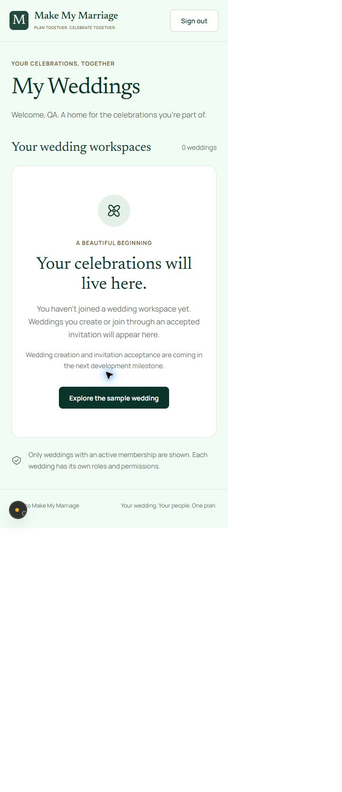

# Website QA report — 21 November 2026

## Result

The implemented account flows work locally within the limits below. General-recipient onboarding is blocked by the current email sender configuration. This is a local QA result, not a production release sign-off or a claim that every possible edge case has been exhausted.

Testing combined manual browser journeys in Brave, requests to the running local server backed by MongoDB, Gmail receipt checks, and the existing automated suite. The tested working tree already contained uncommitted authentication changes. No application fixes were made during this pass.

## Signup and onboarding

| Case | Result | Evidence / qualification |
| --- | --- | --- |
| Homepage Sign up entry | Pass | Opens the registration form. |
| Empty required fields | Pass | Browser blocks submission and identifies a required field. |
| Malformed email | Pass | Browser rejects invalid input; server independently returns 400 `INVALID_EMAIL`. |
| Whitespace-only name | Pass, API | Server returns 400 `INVALID_REGISTRATION_DETAILS`. |
| Country code without `+` | Pass | Specific client validation message. |
| Alphabetic phone number | Pass | Specific client validation message; invalid combined phone is rejected by the server. |
| Phone number containing spaces | Pass | Accepted and normalized during signup. |
| Empty password | Pass, API | 400 `VALIDATION_ERROR`. |
| Password longer than 128 characters | Pass, API | 400 `PASSWORD_TOO_LONG`. Initial attempts were rate-limited; these results are from the later check after cooldown. |
| Password show/hide | Pass | Input changes to visible text and back. |
| New Gmail alias registration using original Resend settings | Blocked | Signup showed the check-email notice, but the server logged `Verification email delivery failed`. No corresponding message was found in Gmail, including spam/trash search. |
| Login before verification | Pass | Correct password gets an email-verification notice; no private workspace is issued. |
| Fresh synthetic registration and verification | Pass, local capture | Registered `qa-manual-20261121@example.test`, received its verification link in a temporary loopback email sink, opened the link, and reached the verified login form. This does not prove Gmail delivery for new registrations. |
| Verified password login / uppercase email | Pass | Uppercase email and the registered password reached My Weddings. |
| Unicode / HTML-like display name | Pass | Leading/trailing spaces were trimmed. Unicode and `` appeared as literal text, with no script execution observed. |
| Duplicate verified registration | Pass | Same public check-email response; local inbox received the already-member notice. Subsequent login retained the original account identity. |
| New-user private workspace | Pass | My Weddings showed zero weddings and the future-feature notice, without the sample wedding in the private list. |

## Login and sessions

| Case | Result | Evidence / qualification |
| --- | --- | --- |
| Incorrect password | Pass | Generic mismatch feedback; no session issued. |
| Existing Google account login | Pass | Account chooser and returning-user Continue completed the callback to My Weddings. |
| Google cancellation and retry | Pass | Cancel returned to login with generic feedback; retry succeeded. |
| Refresh persistence | Pass | Signed-in My Weddings survived reload. |
| Signed-in signup entry | Pass | Redirected to My Weddings. |
| Authenticated `/api/v1/me` | Pass | Returned the signed-in identity and empty memberships; phone was absent. |
| Authenticated `/api/v1/weddings` | Pass | Returned an empty data list. |
| Sign out / protected-page revisit | Pass | `/weddings` returned the browser to `/login`. |
| Anonymous protected APIs | Pass | Both application endpoints returned 401 and `Cache-Control: no-store`. Anonymous provider session returned null. |
| Forged session cookie | Pass, API | Both protected application endpoints returned 401 with `no-store`. |
| Untrusted request origin | Pass, API | Login request from a synthetic foreign origin returned 403 `INVALID_ORIGIN`. |
| Request rate limiting | Pass | Repeated invalid signup/code checks produced 429. Code verification worked after cooldown. |

The anonymous `/weddings` HTTP request returned status 200 because the development response streams the redirect. The browser's final login URL, rather than an assumed HTTP 302, was used to verify the redirect.

## Forgot password and Gmail delivery

| Case | Result | Evidence / qualification |
| --- | --- | --- |
| Forgot password entry | Pass | Login link opens the email-code flow. |
| Unknown email | Pass | Shows the same conditional check-inbox notice; existing automated test confirms no email is sent for an unknown account. |
| Actual Gmail receipt | Pass | A fresh reset email reached the connected Gmail inbox at 22:10 IST on 21 November. The existing user's password was not changed. |
| Short / alphabetic code | Pass | Browser pattern validation blocks submission. Server independently rejects malformed codes with 400 `INVALID_OTP`. |
| Wrong code | Pass | Error shown; new-password fields remain unavailable. |
| Wrong OTP purpose | Pass, API | 400 `INVALID_OTP`. |
| Disabled OTP-login endpoint | Pass, API | 404. |
| Repeated incorrect code attempts | Partial | Three wrong attempts failed, and the next check was rate-limited. This live sequence does not independently distinguish the OTP-specific attempt counter from the route rate limiter. |
| Resend invalidates previous code | Pass, live API | Previous code rejected after replacement was issued. |
| Correct replacement code | Pass, live API | Verified successfully after the configured rate-limit cooldown. |
| Password replacement | Pass, live API | Reset completed on the disposable account. No existing personal account password was changed. |
| Reuse of reset code | Pass, live API | Used code was rejected. |
| Revocation after reset | Pass, live API | A session issued before reset subsequently returned null. |
| Old versus new password | Pass | Old password returned 401; replacement password succeeded through both the API and browser login. |

The final password-reset form submission and mismatch-message interaction were not performed manually. Password replacement was exercised through the live API on synthetic data and through the existing isolated integration test. Five-minute code expiry was not timed in this pass.

## Homepage and responsive checks

Overview, Tasks, and Expenses preview selection worked. All five FAQ controls were exercised. The mobile menu expanded, its Features link navigated to the section, and the menu closed. DOM inspection found no broken internal anchor targets. At the effective narrow viewport of 480 CSS pixels, the homepage had no horizontal overflow; account and My Weddings layouts remained usable. The browser override clamped requests for 320 pixels to 480, so 320/390-pixel coverage is not claimed in this pass. Desktop journeys also completed. The final browser error-log check was empty.

## Open findings

1. **P1 — General-recipient email delivery blocks onboarding.** With the original local settings, a fresh Gmail alias got a success-style notice but no verification email. The server logged delivery failure. The documented Resend test sender is restricted to its authorized inbox. Configure and verify a sender domain, test a separate recipient, and include observable delivery-failure handling before public release. Synthetic local capture proves application flow only.
2. **P1 — One-character passwords remain accepted.** Existing configuration and the passing integration test explicitly permit this. This is the current intentional policy, but remains a public-release security finding; this QA pass did not change that policy.
3. **P2 — Session renewal remains unresolved.** The recorded review finding in `PROJECT_STATUS.md` still applies: server session reads can refresh database expiry without forwarding the refreshed browser cookie. This pass verified ordinary persistence and reset revocation, not multi-day renewal.
4. **P2 — No recipient-level recovery cooldown.** Source/route rate limiting was observed. The existing review's cross-source inbox-flooding/code-supersession concern remains open; distributed sending was not attempted.

## Checks and remaining coverage

- `npm test`: **32 tests passed across 6 files**.
- `npm run lint`: **passed**.
- `npm run typecheck`: **passed**.
- `npm run build`: **passed** with normal local permissions. The initial sandboxed attempt stalled during compilation and was stopped; the retry completed successfully.
- Temporary synthetic email configuration was restored **byte-for-byte** from its backup, and the loopback email sink was stopped. Browser test sessions were signed out and the viewport override was cleared.
- Two test registrations remain in the development database: the unverified Gmail alias and the verified `example.test` account. They have no wedding memberships. They were retained as test evidence; no real weddings were created or altered.

Still required: hosted HTTPS/provider callbacks; new or unregistered Google account rejection; Google linking to an existing verified password account; actual signup delivery to a separate real inbox; expired/invalid registration links; timed OTP expiry and independent OTP attempt exhaustion; manual reset confirmation/mismatch flow; administrative revocation, natural session expiry and renewal; isolation between populated wedding accounts; network interruption/offline recovery; exact 320/390-pixel, other-browser, keyboard-only and screen-reader testing. Wedding creation, invitations, RSVP, planning, finance, and gallery workflows are not implemented and cannot be tested as working features yet.
